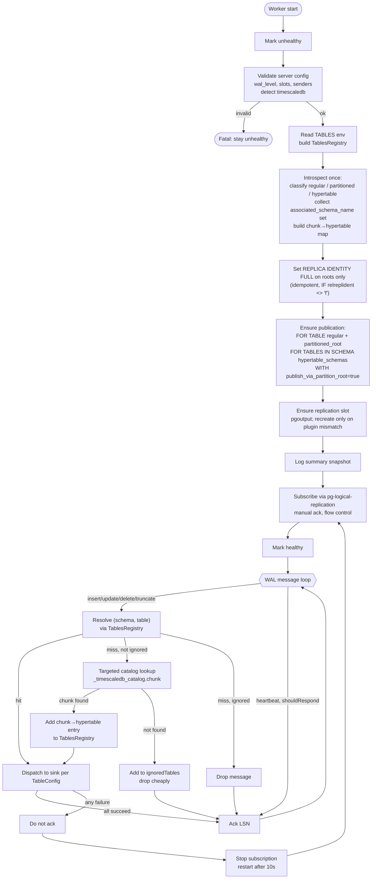

# ECST Worker — WAL Flow PRD

Consolidated design for the ECST worker's PostgreSQL logical replication setup
and runtime. Incorporates `publish_via_partition_root = true` for native
partitioned tables, `FOR TABLES IN SCHEMA` for TimescaleDB hypertables, and
targeted per-chunk resolution in place of full re-introspection.

## Assumptions

- PostgreSQL ≥ 15 (required for `FOR TABLES IN SCHEMA`).
- TimescaleDB present; hypertables use the default `_timescaledb_internal`
  `associated_schema_name` unless a custom one is configured. The final set of
  schemas is discovered at startup.
- [unconfirmed] TSDB propagates `REPLICA IDENTITY` to existing chunks when
  `ALTER TABLE <hypertable> REPLICA IDENTITY ...` is run. Propagation to new
  chunks on creation is confirmed in recent 2.x releases.

## Concepts (reference)

- **Publication** — named set of tables + row operations to publish, declared
  on the publisher.
- **Subscription** — consumer on the downstream side. In this worker's case,
  the "subscription" is a custom `pg-logical-replication` client, not a
  PostgreSQL `CREATE SUBSCRIPTION` object.
- **Replication slot** — publisher-side state tracking consumed LSN; pins WAL
  until consumed.
- **Replica identity** — how UPDATE/DELETE rows are identified in WAL. `FULL`
  logs all old columns; required here because configured tables are not
  guaranteed to have unique keys suitable for default RI.
- **`publish_via_partition_root`** — native-PG-partitioning-only flag that
  publishes leaf-partition writes under the root's identity. Has **no effect**
  on TimescaleDB hypertables because their root is `relkind='r'` (plain
  table), not `relkind='p'` (native partitioned).
- **`FOR TABLES IN SCHEMA`** — publication clause that auto-includes all
  present and future tables in a schema. Used to capture TSDB chunks without
  enumerating them.

## Flow diagram

## Startup flow

1. **Mark unhealthy** — `AppStateHealthService.markUnhealthy(...)`; probes fail
   until setup completes.
2. **Validate server config** — `wal_level=logical`, `max_replication_slots≥1`,
   `max_wal_senders≥1`; detect `timescaledb` extension; check whether target
   publication already exists.
   - Reuse: `/Users/sergeyzwezdin/Sources/relab/startwatch/apps/ecst-worker/src/wal/queries/get-database-configuration.query.ts`.
3. **Read config** (`TABLES` env) → build `TablesRegistry`.
   - Reuse: `/Users/sergeyzwezdin/Sources/relab/startwatch/apps/ecst-worker/src/wal/ecst.config.ts`,
     `/Users/sergeyzwezdin/Sources/relab/startwatch/apps/ecst-worker/src/wal/registries/table-registry.ts`.
4. **Introspect once** — classify each configured table as
   `regular | partitioned | hypertable`; for hypertables record distinct
   `associated_schema_name`s; populate chunk → hypertable map.
   - Modify: `/Users/sergeyzwezdin/Sources/relab/startwatch/apps/ecst-worker/src/wal/queries/get-tables-with-partitions.query.ts`
     — drop the native-partition children branch (no longer used). Keep the
     hypertable-chunk branch. Add selection of
     `_timescaledb_catalog.hypertable.associated_schema_name` for each
     hypertable.
   - Modify: `/Users/sergeyzwezdin/Sources/relab/startwatch/apps/ecst-worker/src/wal/queries/introspect-tables.query.ts`
     — emit only the chunk → hypertable mapping (no native-partition child
     mapping) and the set of associated schemas.
   - Modify: `/Users/sergeyzwezdin/Sources/relab/startwatch/apps/ecst-worker/src/wal/database-introspection.service.ts`
     — `invalidate()` no longer iterates native-partition children.
5. **Set REPLICA IDENTITY FULL** on roots only, idempotently:
   - Regular tables: root.
   - Native partitioned tables: root only (children covered by
     `publish_via_partition_root = true` using the root's identity).
   - Hypertables: root only (TSDB propagates to chunks).
   - Modify: `/Users/sergeyzwezdin/Sources/relab/startwatch/apps/ecst-worker/src/wal/commands/update-replica-identity.command.ts`
     — remove the per-partition expansion for native partitioned tables (lines
     around 60–66 in current file). After change, the command targets only
     parent `(schema, table)` pairs regardless of `type`. Keep the
     `IF NOT EXISTS ... relreplident = 'f'` guard so repeated runs are no-ops.
6. **Ensure publication** `<WORKER_NAME>_pub`:
   - `FOR TABLE <regular>, <partitioned_root>` for regular + native partitioned
     tables.
   - `FOR TABLES IN SCHEMA <schema>` for each distinct hypertable
     `associated_schema_name`.
   - `WITH (publish_via_partition_root = true)`.
   - Create if missing, otherwise `ALTER PUBLICATION ... SET` to reshape.
   - Modify: `/Users/sergeyzwezdin/Sources/relab/startwatch/apps/ecst-worker/src/wal/commands/ensure-publication-exists.command.ts`
     — input should be `{ tables: [...], hypertableSchemas: [...] }`; emit the
     two clauses above.
7. **Ensure replication slot** `<WORKER_NAME>_slot` with `pgoutput`:
   - Create if missing; recreate only if plugin mismatches. Drop fails if
     active — protects a running worker.
   - Reuse as-is: `/Users/sergeyzwezdin/Sources/relab/startwatch/apps/ecst-worker/src/wal/commands/ensure-replication-slot-exists.command.ts`.
8. **Log summary snapshot** for observability.
   - Reuse: `/Users/sergeyzwezdin/Sources/relab/startwatch/apps/ecst-worker/src/wal/queries/get-database-summary.query.ts`.
9. **Subscribe** via `pg-logical-replication` with `acknowledge.auto = false`
   and `flowControl.enabled = true`.
   - Reuse: `/Users/sergeyzwezdin/Sources/relab/startwatch/apps/ecst-worker/src/wal/wal.service.ts`.
10. **Mark healthy** — `AppStateHealthService.markHealthy()`.

## Runtime flow

For each WAL message `(lsn, log)` delivered to
`WalService.onData` in `/Users/sergeyzwezdin/Sources/relab/startwatch/apps/ecst-worker/src/wal/wal.service.ts`:

1. Resolve `(schema, table)` via `TablesRegistry`:
   - Regular / native partitioned (via `publish_via_partition_root=true`):
     arrives under root → direct hit.
   - Hypertable chunk: arrives under the chunk relation → registry lookup of
     chunk → hypertable → `TableConfig`.
2. **On unknown chunk** (chunk created after startup): targeted lookup only.
   - Query `_timescaledb_catalog.chunk` for the single `(schema, table)` to
     find its hypertable; insert one entry into `TablesRegistry`.
   - Do **not** run `UpdateReplicaIdentityCommand` — TSDB has already
     propagated RI to the new chunk at creation time.
   - If still not resolved, add to `ignoredTables` and drop cheaply.
   - Modify: `/Users/sergeyzwezdin/Sources/relab/startwatch/apps/ecst-worker/src/wal/database-introspection.service.ts`
     — replace the current `invalidate({schema, table})` full re-introspection
     path (method `resolveTableConfiguration`, around lines 83–105) with a
     targeted lookup. The full `invalidate()` runs only at startup.
   - Modify: `/Users/sergeyzwezdin/Sources/relab/startwatch/apps/ecst-worker/src/wal/queries/get-table-by-partition.query.ts`
     — ensure it returns just the parent hypertable for a single chunk pair
     without re-running the broad introspection.
3. Dispatch to the configured sink (custom Go handler) per matching
   `TableConfig`. The sink is an abstraction over the downstream target; its
   contract is "accept a change event, return success/error." Fan-out
   semantics (multiple `TableConfig`s per physical table) are preserved.
4. Ack LSN only after all sink dispatches succeed. On any failure: don't ack;
   stop subscription; restart after 10s → PG replays from last ack →
   at-least-once.
5. Heartbeats: ack LSN only when `shouldRespond = true`.

## Changes vs. current implementation

| Area | Current behavior | Proposed behavior |
|---|---|---|
| Introspect native-partition children | Enumerated by `GetTablesWithPartitionsQuery` | Dropped — not needed with `publish_via_partition_root=true` |
| Introspect hypertable chunks | Enumerated; built chunk→hypertable map | Kept; also collect distinct `associated_schema_name`s |
| `UpdateReplicaIdentityCommand` inputs | Expands native partitions per child | Roots only for all types |
| Re-invalidate on unknown chunk | Full re-introspection of every configured table | Single-chunk catalog lookup |
| Re-run `UpdateReplicaIdentityCommand` at runtime | Yes (no-op for hypertables) | Dropped — not needed |
| Publication shape | `TABLE` for regular/partitioned + `TABLES IN SCHEMA` for hypertable chunk schemas, `publish_via_partition_root=true` | Same (already correct) |
| Slot management | Idempotent, recreate on plugin mismatch, drop blocked while active | Same (already correct) |

## Files modified

- `/Users/sergeyzwezdin/Sources/relab/startwatch/apps/ecst-worker/src/wal/queries/get-tables-with-partitions.query.ts`
- `/Users/sergeyzwezdin/Sources/relab/startwatch/apps/ecst-worker/src/wal/queries/introspect-tables.query.ts`
- `/Users/sergeyzwezdin/Sources/relab/startwatch/apps/ecst-worker/src/wal/queries/get-table-by-partition.query.ts`
- `/Users/sergeyzwezdin/Sources/relab/startwatch/apps/ecst-worker/src/wal/commands/update-replica-identity.command.ts`
- `/Users/sergeyzwezdin/Sources/relab/startwatch/apps/ecst-worker/src/wal/commands/ensure-publication-exists.command.ts`
- `/Users/sergeyzwezdin/Sources/relab/startwatch/apps/ecst-worker/src/wal/database-introspection.service.ts`

## Files unchanged (reused as-is)

- `/Users/sergeyzwezdin/Sources/relab/startwatch/apps/ecst-worker/src/wal/wal.service.ts`
- `/Users/sergeyzwezdin/Sources/relab/startwatch/apps/ecst-worker/src/wal/ecst.config.ts`
- `/Users/sergeyzwezdin/Sources/relab/startwatch/apps/ecst-worker/src/wal/registries/table-registry.ts`
- `/Users/sergeyzwezdin/Sources/relab/startwatch/apps/ecst-worker/src/wal/database-connection.service.ts`
- `/Users/sergeyzwezdin/Sources/relab/startwatch/apps/ecst-worker/src/wal/commands/ensure-replication-slot-exists.command.ts`
- `/Users/sergeyzwezdin/Sources/relab/startwatch/apps/ecst-worker/src/wal/queries/get-database-configuration.query.ts`
- `/Users/sergeyzwezdin/Sources/relab/startwatch/apps/ecst-worker/src/wal/queries/get-database-summary.query.ts`

## Defensive extras (optional)

- **Per-chunk RI audit at startup.** In `UpdateReplicaIdentityCommand`
  (`/Users/sergeyzwezdin/Sources/relab/startwatch/apps/ecst-worker/src/wal/commands/update-replica-identity.command.ts`),
  iterate chunks with the existing `IF NOT EXISTS ... relreplident='f'` guard
  so any chunk where TSDB propagation failed gets repaired. Cheap (one
  catalog check per chunk) and only runs at startup.
- **Startup verification query** on `_timescaledb_catalog.chunk` joined with
  `pg_class.relreplident`; log a warning for chunks whose RI doesn't match
  the hypertable's RI. Surfaces propagation gaps without altering anything.

## Out of scope

- DDL drift detection on configured tables (added columns, type changes). Not
  needed: WAL carries whatever columns each chunk has at emit time; the
  handler forwards row payloads without a cached column list.
- Dynamic reload of `TABLES` env at runtime; still requires worker restart.
- Initial `COPY` of historical rows; stream starts from slot LSN.
- Distributed / multi-node TimescaleDB hypertables.
- PostgreSQL versions < 15 (no `FOR TABLES IN SCHEMA`).
